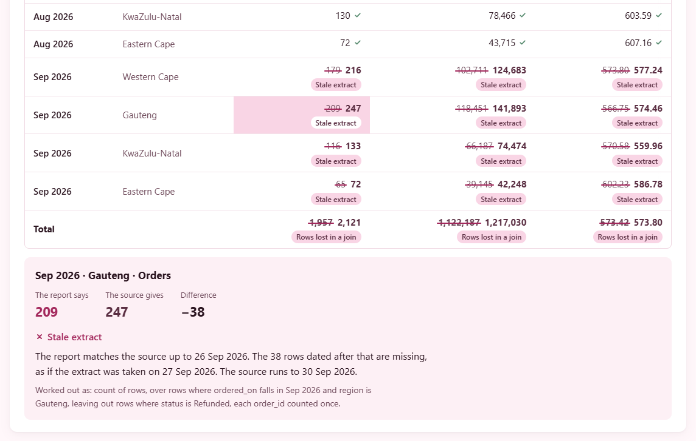
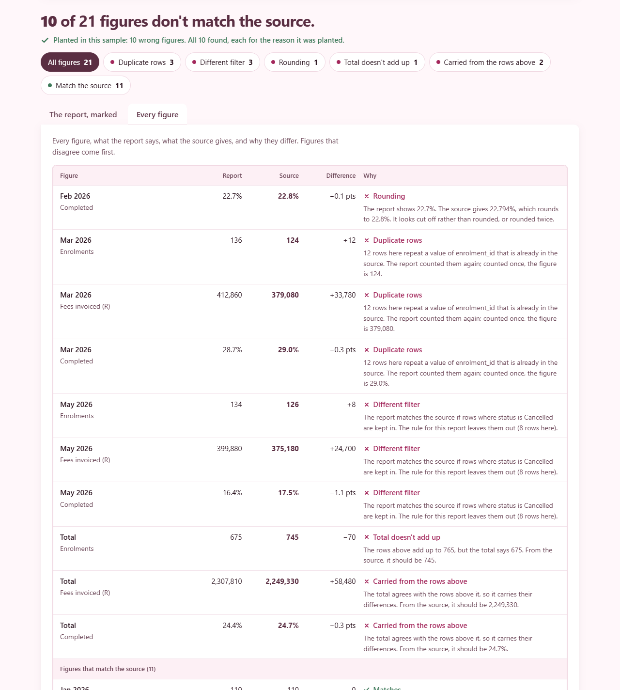
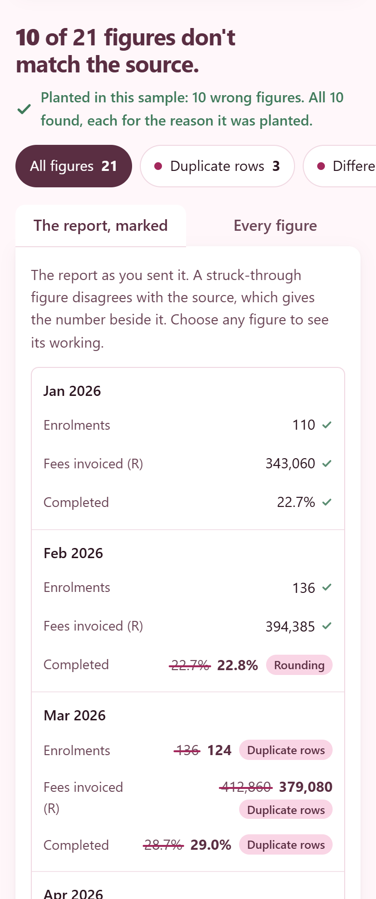

# Report Checker

**Add a finished report and the data it was made from. Every figure is worked out again from the source, and each one that disagrees gets its likely cause: rounding, a different filter or date range, duplicate rows, a stale extract, rows lost in a join, or a total that doesn't add up. It all runs in the browser, so no file leaves your machine.**

**Live page:** https://nurah-kamal.github.io/reporting-and-bi/report-checker/ (click "Try a sample").


## What it shows

One page, in the order you use it.

| Part | The question it answers |
| --- | --- |
| **Try a sample** | What does this do? Three invented ops reports, each with mistakes planted in them |
| **Or check your own** | A CSV or Excel report and its source, read in the browser |
| **How each figure is worked out** | Which columns pair report rows with source rows, which rows are left out, and what each figure counts or adds up |
| **The verdict** | How many figures disagree with the source, and for a sample, whether every planted mistake was found |
| **Reasons** | How many figures each cause explains. Tapping one filters both views |
| **The report, marked** | The report as it was sent, with each wrong figure struck through and the source's figure beside it |
| **Every figure** | One line per figure: what the report says, what the source gives, the difference and why |
| **How it decides** | The order the causes are tried in, and what the checker can't tell |

On the three samples it finds all 41 planted mistakes, each for the reason it was planted, and passes all 58 clean figures.

## The part worth copying

My working rule is "check the source before trusting the number". Before a report goes out, the figures get recalculated from the extract they came from. This project turns that habit into a tool, and the checks sit in the tests rather than in a document:

- **A cause is named only when it reproduces the number.** For a figure that disagrees, the checker changes the source rows in one specific way, recalculates, and names the cause only if that gives the report's figure exactly. When nothing does, it says "no single cause found" instead of guessing.
- **Compared at the precision the report shows.** 80.6% agrees with 80.64 and not with 80.66. A figure within one step of the shown precision that still disagrees is a rounding problem: cut off instead of rounded, or rounded twice.
- **Totals are checked twice.** First against the rows above them, then against the source. A total that adds up but is still wrong carries the rows' mistakes; one whose rows don't cover every source row has lost some, usually to an inner join.
- **Planted, then found.** Each sample is made by a script from a fixed seed, with its mistakes planted on purpose and every figure they change written down. The tests fail if any planted mistake is missed, flagged for the wrong reason, or if any clean figure is flagged at all.
- **Nothing leaves the browser.** Files are read with the browser's own file and decompression APIs. Apart from loading the page itself, the only requests it makes are for the sample files.
- **No person is in the data.** Not a real one and not a made-up one. The rows are enrolments, orders and tickets, identified by a reference like `TCK-48107`, and a test fails if a column ever looks like a name, an email address or a phone number.

## The report, marked



Each figure in the report is a button. Choosing one opens its working: the report's figure, the source's, the difference, the cause in plain words, and exactly how the figure was recalculated ("count of rows, over rows where ordered_on falls in Sep 2026 and region is Gauteng, leaving out rows where status is Refunded, each order_id counted once").

When several figures look stale, the checker looks for one cut-off date that explains all of them, so the whole report gets the same story: matches up to 26 September, as if the extract was taken on the 27th.

## Every figure



The same results as a reconciliation sheet, wrong figures first. This is the view to copy into an email to whoever made the report.

## How each figure is worked out


For your own files the page makes a first guess from the column names and values, and every part of it can be changed. On all three samples the guess lands on the sample's own rules except the one thing no guess can know: which rows the report is meant to leave out. With that rule missing, the checker flags the figures and suggests it ("the report matches the source if rows where category is Spam are left out").

What it can calculate: count rows, add up a column, average a column, the share of rows where a column has a value, and the number of different values. Report rows can be paired on one column or several, and a date column can be read as its month.

## Excel without a library

An `.xlsx` file is a zip of XML files. [src/xlsx.js](src/xlsx.js) reads the zip directory, inflates each part with the browser's `DecompressionStream`, and reads the cells with a few regular expressions. Each cell comes back as the text Excel would show: 0.8065 in a cell formatted `0.0%` reads as 80.7%, and a date serial reads as a date. The sales sample's report is a real workbook with a title row, number formats and a named sheet, and the tests read it back.

## The samples

| Sample | Report | Planted |
| --- | --- | --- |
| **Monthly enrolments** | CSV, January to June 2026 | 12 enrolments imported twice in March; cancelled enrolments kept in for May; February's completion rate cut off instead of rounded; a total with two digits swapped |
| **Sales by region** | Excel, July to September 2026 by region | September pulled from an extract taken on the 27th; a new store missing from the region table, so its orders fall out of the total; one average cut off |
| **Support tickets** | CSV, July to September 2026 by channel | July counted to the 30th; spam left in for August chat; 11 September email tickets imported twice |

How each one is made, and why the totals carry what they carry, is in [docs/SAMPLES.md](docs/SAMPLES.md).

<p align="center"></p>

## How it is built

No framework. No dependencies. Nothing to install.

| | |
| --- | --- |
| **The library** | Plain ES modules in `src/`: reading CSV and Excel, parsing figures the way reports print them, dates, the column guess and the checks. The same files run in Node, in the tests and on the page. |
| **The checks** | [src/check.js](src/check.js). Each cause is a small function that changes the source rows one way and reports whether that reproduces the figure. The order they run in is in [docs/HOW_IT_CHECKS.md](docs/HOW_IT_CHECKS.md). |
| **The samples** | `scripts/make-samples.js` makes the source data from a fixed seed, works out each report twice (from the right rows and from the rows the planted mistakes use) and writes down every figure that differs. |
| **The page** | Plain HTML, CSS and JavaScript. The reader's files are read with `File.arrayBuffer()` and never sent anywhere. |
| **The tests** | 38 tests: every planted mistake found for the right reason, every clean figure passing, each cause on a small hand-made table, the column guess, figure parsing, CSV edge cases, the Excel reader on number formats, inline strings, 1904 dates and broken files, and that the committed samples match the generator. |
| **CI** | `report-checker.yml` at the root of [reporting-and-bi](https://github.com/nurah-kamal/reporting-and-bi) runs check, test and build whenever anything in `report-checker/` changes. The repository's Pages site publishes this folder's `dist/` at `/report-checker/`. Actions are pinned to exact commits. |

## Try it on your own machine

Node 22.13 or later. Nothing to install.

```bash
npm run build
npm run serve
```

Then open http://localhost:4173. A link such as http://localhost:4173/#sample=sales opens straight onto a sample.

To check everything, which is what CI runs:

```bash
npm run check
npm test
```

`npm run check` confirms every script parses, the JSON is valid and every link in the docs points at a real file. `npm run samples` remakes the samples from their seeds.

## Things worth knowing

**A named cause is the simplest one that fits.** It reproduces the figure, which makes it likely, not proven. Two mistakes in one figure, or a figure made with a calculation the checker doesn't offer, show as "no single cause found". Those are the ones to look at by hand.

**Reports are read one way round.** One row per group, with the figures in columns. A report with months across the top needs turning round first.

**Month labels are read generously.** "Mar 2026", "March 2026", "2026-03" and "Mar-26" all mean March 2026. Dates in the source can be `2026-03-04`, `2026/03/04` or day-first `04/03/2026`.

**Old `.xls` files can't be read.** Save them as `.xlsx` or CSV first. Very large workbooks (zip64) aren't supported either.

**The data is invented.** It shows the method, not any real organisation's figures. The idea comes from reporting work I do professionally; it was rebuilt from scratch, and no work code or data is in this repository.

## Folders

```
src/                     reading files, figures, dates, the column guess and the checks
scripts/make-samples.js  makes the three samples from fixed seeds
scripts/xlsx-write.js    writes the Excel sample (and test workbooks) with no library
scripts/build.js         builds dist/: the page, the library and the samples
scripts/serve.js         a small static server for dist/
scripts/check.js         parse, JSON and doc-link checks
site/                    the page
samples/                 the three report pairs and what was planted in each
tests/                   the samples, each cause, and reading files
docs/                    how the checks work, how the samples are made
```

## The design

Written down in [DESIGN.md](DESIGN.md): the colour tokens for light and dark mode (shared with [SA Turnaround](https://github.com/nurah-kamal/reporting-and-bi/tree/main/sa-turnaround)), the marks the checker makes on a report, the type sizes, and the one piece of motion.

## Licence

MIT. Use it for anything, including at work.
