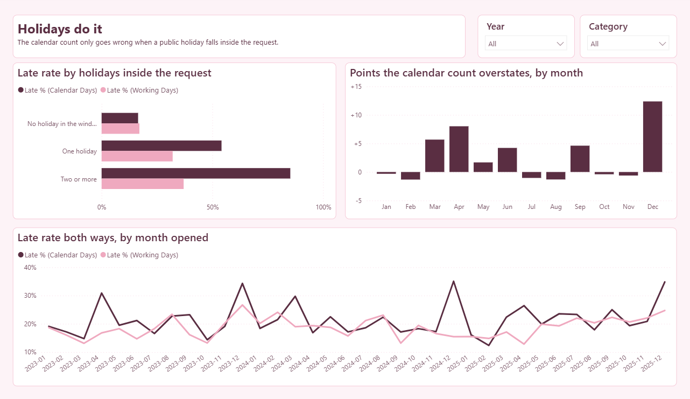
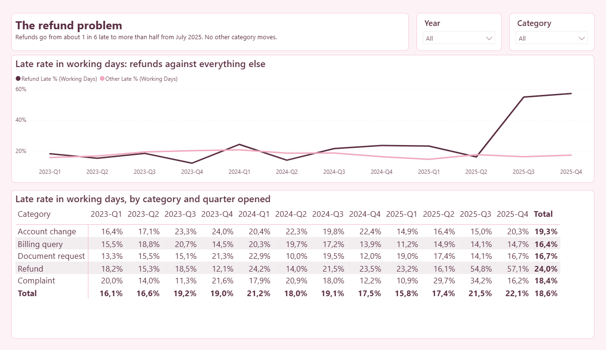
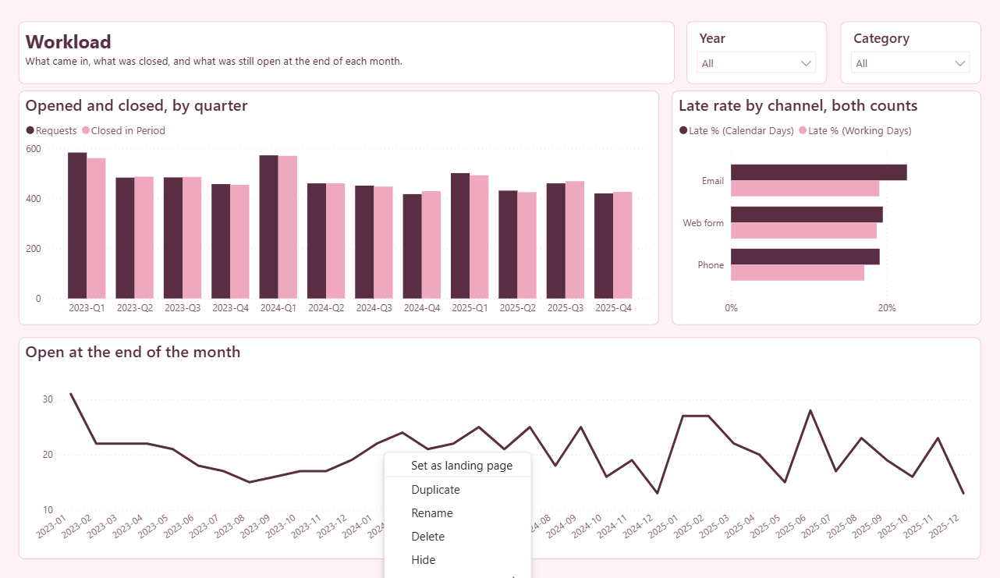

# SA Turnaround in Power BI

**The SA Turnaround analysis rebuilt as a Power BI model: a star schema, a date table that knows every South African public holiday, and 23 measures that count turnaround in working days. Every figure on the report matches the SQL version to the request.**

The original project, with the working-day library and the SQL, is at [reporting-and-bi/sa-turnaround](https://github.com/nurah-kamal/reporting-and-bi/tree/main/sa-turnaround). This one asks the same question in the tool most BI teams use.


## What it shows

Four pages, each with Year and Category filters.

| Page | The question it answers |
| --- | --- |
| **Late by which count?** | How many requests each count calls late, how often the two disagree, and the late rate by quarter in whichever count you pick |
| **Holidays do it** | Whether a public holiday inside the request is what makes the calendar count go wrong, and in which months |
| **The refund problem** | With holidays out of the way, which category is really late, quarter by quarter |
| **Workload** | What came in, what was closed, what was still open at each month end, and how the channels compare |

The finding, on the synthetic data: counting calendar days calls **1,183** requests late. **283** of those were on time once public holidays are counted, and **160** real delays were missed. In working days, one real problem is left: refunds, **16.1%** late in the second quarter of 2025, then **54.8%** and **57.1%** after a second sign-off step was added in July 2025. No other category moves.

## The part worth copying

- **Working days are a subtraction, not a loop.** The date table carries a running count of working days. Working days between two dates is the count on the closing day minus the count on the opening day, so no measure has to step through dates one by one.
- **The holidays come from code, not a typed list.** The date table is written by the same tested library as the SQL project: the twelve statutory days, Easter, the Sunday rule and each declared day with its source.
- **Two dates, one date table.** Requests link to the date table on the opening date (active) and on the closing date (inactive). `Closed in Period` switches to the closing date with `USERELATIONSHIP`, so the same date filter answers both "opened in March" and "closed in March".
- **Checked against an independent answer.** `data/expected.json` holds the figures worked out in plain code from the same data. The measures were checked against it by DAX query: every headline figure, all 12 refund quarters and the three holiday windows match exactly. A test also checks that `expected.json` agrees with the published SQL results.
- **Measured in the unit the target is written in.** A "3 working day" target is checked in working days. The calendar count is given a fair chance (its target is stretched for weekends), so the only thing left for it to get wrong is public holidays.
- **No person is in the data.** Not a real one and not a made-up one.



## The measures

All on the Requests table, in display folders.

| Measure | What it means |
| --- | --- |
| **1 Counts** | |
| Requests | Requests opened in the period |
| Closed Requests | Requests opened in the period that have closed. Every turnaround measure is over these |
| Open Requests | Requests opened in the period and still open on 31 Dec 2025 |
| Closed in Period | Requests closed in the period, whenever they were opened (uses the inactive closing-date relationship) |
| Open at Period End | The backlog: opened by the last day of the period and not yet closed on that day |
| Working Days in Period | Weekdays in the period that are not public holidays |
| **2 Turnaround** | |
| Median Calendar Days | Middle turnaround of closed requests, counting every day |
| Median Working Days | Middle turnaround of closed requests, counting working days only |
| Average Working Days | Mean turnaround in working days; pulled up by the few requests that wait on someone else |
| **3 Late** | |
| Late by Calendar Days | Closed requests over the weekend-stretched target in calendar days |
| Late by Working Days | Closed requests over the target in working days |
| Late % (Calendar Days) | Share of closed requests late by the calendar count |
| Late % (Working Days) | Share of closed requests late in working days |
| Late % (Chosen Count) | Either of the two above, whichever the *Count days as* slicer picks |
| **4 Where they disagree** | |
| Wrongly Late | Late by the calendar count, on time once public holidays are counted |
| Wrongly Late % | Share of the calendar count's late requests that were on time |
| Missed Late | Late in working days, but the calendar count said on time (its weekend stretch hands out extra days even when no weekend falls inside) |
| Late Gap (pts) | Percentage points by which the calendar count overstates the late rate |
| **5 Over time** | |
| Late % (Working Days) LY | The working-day late rate for the same period a year earlier (`SAMEPERIODLASTYEAR`) |
| Late % (Working Days) YoY (pts) | Change against the same period last year, in percentage points |
| Late % (Working Days) PQ | The working-day late rate in the previous quarter (`DATEADD`) |
| Refund Late % (Working Days) | Working-day late rate for refunds only, whatever category is selected |
| Other Late % (Working Days) | Working-day late rate for every category except refunds |



## How it is built

| | |
| --- | --- |
| **The data** | `scripts/make-data.js` writes four CSVs and `expected.json` from a fixed seed. It uses SA Turnaround's own generator and working-day library, copied into `scripts/requests.js` and `src/`, so the 5,719 requests are byte-identical to that project's sample. |
| **The model** | A star schema in Import mode: Requests in the middle; Date (marked as the date table), Category and Channel around it. Power Query loads each CSV with explicit types from one `DataFolder` parameter. Auto date/time is off, because the model has its own date table. |
| **Calculated columns** | On Requests: Calendar Days, Working Days, Weekday Holidays Inside, Late (Calendar Days), Late (Working Days), Holiday Window and Verdict. |
| **The slicer switch** | `Count Days As` is a field parameter table. The chart beside it uses `Late % (Chosen Count)`, which reads the slicer with `SELECTEDVALUE` and returns the matching measure. |
| **The report** | Four pages in the PBIR format: one JSON file per visual, so a change to one chart is a small diff. The theme in `theme/` is embedded in the report. |
| **The project** | Saved as a `.pbip`, so the model is TMDL text and the whole thing can be read and reviewed in git. No data is stored in the project; it loads from the CSVs. |
| **The tests** | Five tests: the CSVs match the scripts, the date table has no gaps and covers every request, subtracting the working-day count agrees with the library on every request, and the figures match SA Turnaround's published SQL results. |

## Try it on your own machine

You need Power BI Desktop (Windows, free) to open the report, and Node 22.13 or later for the data and tests. There is nothing to install with npm.

1. Clone the repository and open `SA Turnaround.pbip` in Power BI Desktop.
2. Point the model at your copy of the data: **Home → Transform data → Edit parameters**, and set `DataFolder` to the full path of the `data` folder, ending in a backslash.
3. Click **Apply changes** (or **Home → Refresh**). The four tables load in a few seconds.

To remake the data and run the tests:

```bash
npm run data
npm test
```

## Things worth knowing

**A working day starts the day after opening.** A request opened and closed on the same day took 0 working days. One opened on a Saturday and closed on Monday took 1. This is the same rule as the SQL project.

**The calendar count here is the generous version.** Its target is stretched for weekends (×7/5, rounded up), so the comparison is fair and only public holidays are left for it to get wrong.

**The date table covers 2023 to 2025.** That is every date in the data. A longer period means regenerating the CSVs with a wider range.

**The field parameter feeds a measure, not the chart directly.** A field parameter placed straight on a chart works when it is built by hand in Power BI Desktop, but not when the report file is written outside it. The `SELECTEDVALUE` switch gives the same result and is easier to read in a diff.

**National holidays only.** Provincial days off, company shutdowns and part days are out of scope, as in the SQL project.

**The data is synthetic.** It shows the method, not any real organisation's performance. The idea comes from reporting work I do professionally; it was rebuilt from scratch, and no work data is in this repository.



## Folders

```
SA Turnaround.pbip           open this in Power BI Desktop
SA Turnaround.SemanticModel/ the model as TMDL: tables, measures, relationships
SA Turnaround.Report/        the four report pages, one JSON file per visual
data/                        the CSVs the model loads, and expected.json
scripts/make-data.js         writes the CSVs and expected.json from a fixed seed
scripts/requests.js          SA Turnaround's request generator
src/                         SA Turnaround's working-day library
tests/                       the data tests
theme/                       the report theme
docs/img/                    screenshots for this README
```

## Licence

MIT. Use it for anything, including at work.
