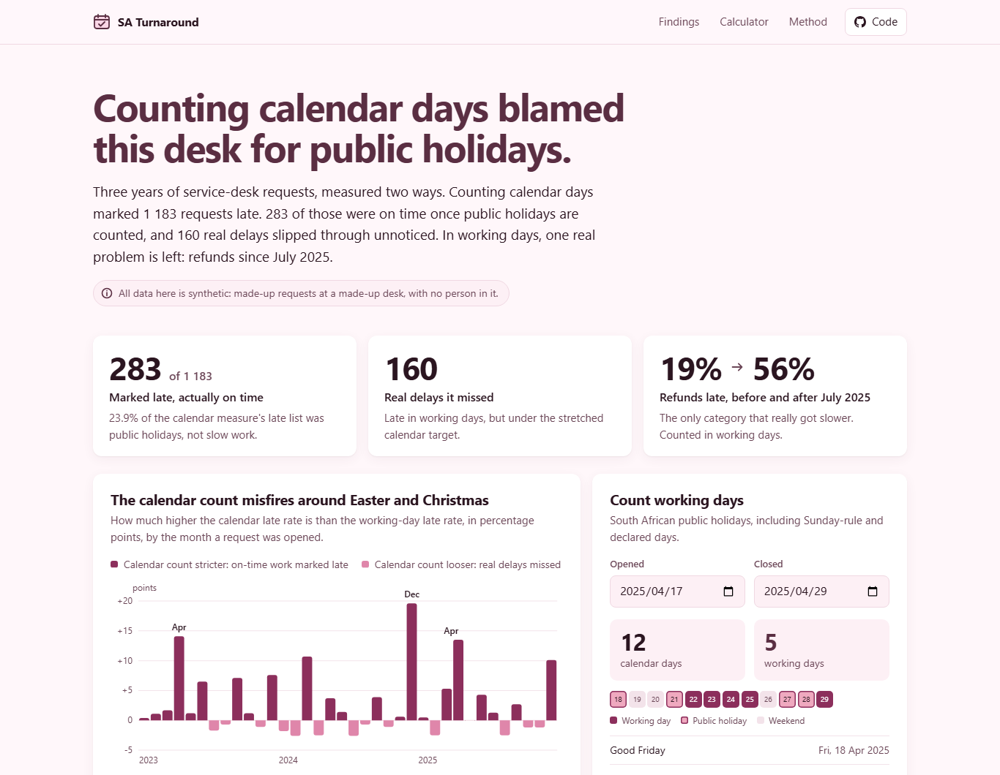
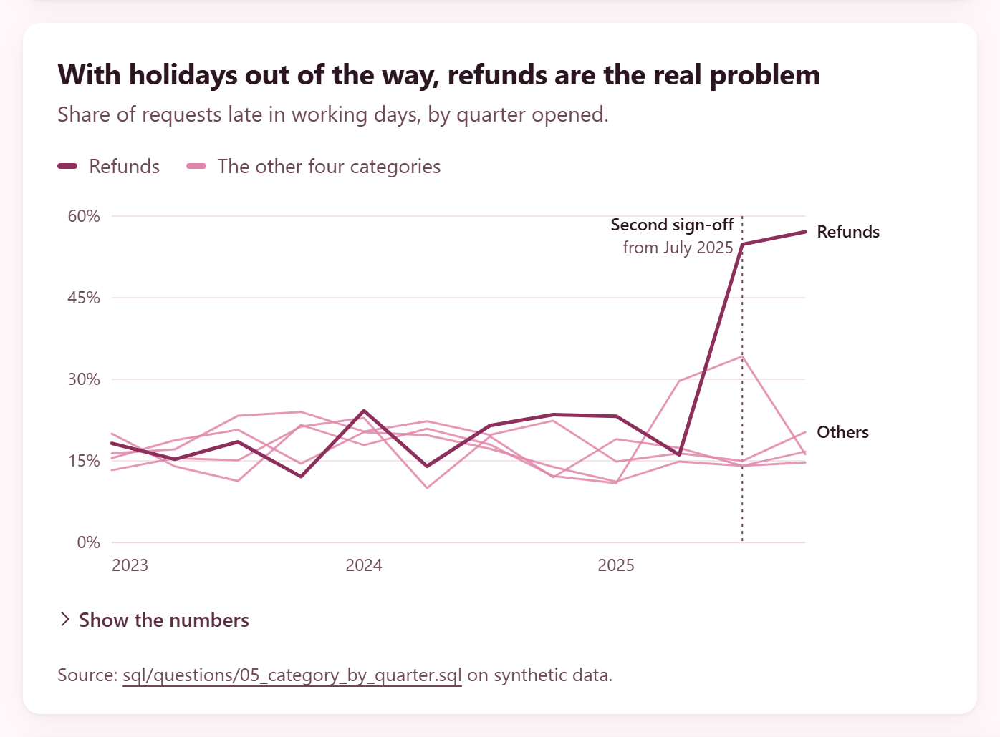
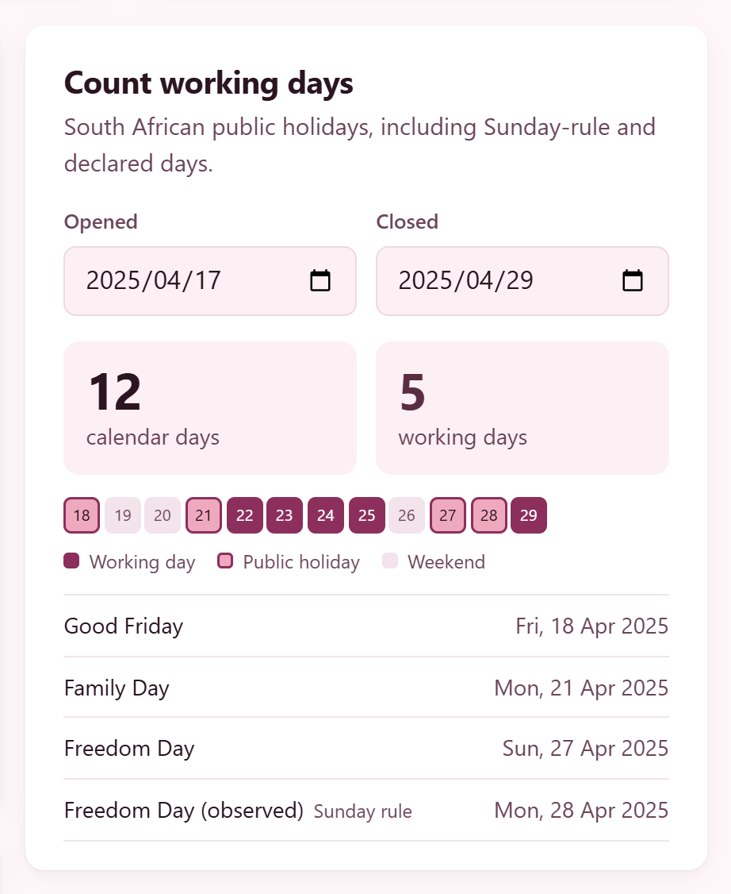
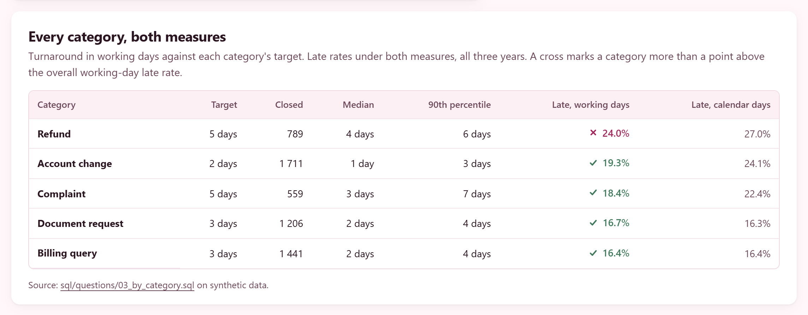

# SA Turnaround

[](https://github.com/nurah-kamal/reporting/actions/workflows/sa-turnaround.yml) 21 tests

**Working days for South Africa, and a one-page report on what counting them properly changes. Every holiday rule has a source, and every number on the page comes from a SQL file you can open.**

**Live page:** https://nurah-kamal.github.io/reporting/sa-turnaround/ (try the calculator with any two dates).



## What the report shows

One page, in the order a reader needs it.

| Section | The question it answers |
| --- | --- |
| **The headline** | What changes when turnaround is counted in working days instead of calendar days |
| **Key figures** | How many requests were called late wrongly, how many real delays were missed, and the one category that really got slower |
| **Where it misfires** | Which months the calendar count gets wrong, and in which direction |
| **Holidays in the window** | Whether a public holiday between opening and closing is what causes it |
| **The real problem** | With holidays out of the way, which category is actually late |
| **Every category** | Median, 90th percentile and late rate per category, under both measures |
| **Count working days** | A calculator: any two dates, the working days between them, and the holidays that fall in the gap |
| **How this was built** | The two measures, the holiday rules, and how the numbers are checked |

The finding, on the synthetic data: counting calendar days marked **1,183** requests late. **283** of those were on time once public holidays are counted, and **160** real delays slipped through. Counted in working days, one real problem is left: refunds, which went from 19% late to 56% after a second sign-off step was added in July 2025. The full write-up is in [docs/FINDINGS.md](docs/FINDINGS.md).

## The part worth copying

Turnaround reports usually subtract one date from another and call it done. This project is built not to, and the checks are in the tests rather than in a document:

- **Measure in the unit the target is written in.** A "3 working day" target is checked in working days. The calendar count is given a fair chance (its target is stretched for weekends), so the only thing left for it to get wrong is public holidays.
- **Every number on the page comes from SQL.** Each chart names the file that produced it, under the chart. Nothing on the page is typed in by hand.
- **Two independent answers are made to agree.** The SQL works out working days from a calendar table; the JavaScript library works them out day by day. For all 5,706 closed requests the two are compared, and the tests fail if they ever disagree.
- **Planted, then found.** The data generator planted one change (the refund sign-off). The tests check that the analysis still finds it and that no other category moved. The holiday effect was not planted: it comes from the calendar alone.
- **A holiday is sourced, not remembered.** Every once-off declared day is listed with the page it was checked against. On 25 October 2026, gov.za's own holiday page did not yet show the 4 November 2026 election day, which the Presidency had already declared.
- **A small group is not a trend.** Complaints jumped to 34% late for one quarter, then fell back to 16%. With about 40 complaints a quarter that is noise, and the write-up says so rather than calling it a second finding.
- **No person is in the data.** Not a real one and not a made-up one. There are no names, contact details or free text in any column.



## The holiday rules

The library follows the Public Holidays Act 36 of 1994, from 1995 onwards.



- **The twelve statutory holidays**, with Good Friday and Family Day worked out from Easter.
- **The Sunday rule.** When a holiday falls on a Sunday, the Monday after it is a holiday too (10 August 2026, 22 March 2027).
- **No chaining.** When Christmas is a Sunday, the Monday is already the Day of Goodwill, so the Act adds nothing more. In 2011, 2016 and 2022 the President declared 27 December instead, and those days are in the declared list.
- **Declared days** (elections, the Rugby World Cup, those 27 Decembers), each with its source. Checked for 2009–2026. Outside those years the calculator says that a declared day could be missing.
- **Two holidays on one date.** In 2008 Good Friday fell on Human Rights Day. That is one day off, so it is one entry with both names.

The rules and every source are in [docs/HOLIDAY_RULES.md](docs/HOLIDAY_RULES.md), along with how to add the next declared day.

## Using the library

```js
import { workingDaysBetween, addWorkingDays, holidaysFor, isWorkingDay } from './src/index.js';

workingDaysBetween('2025-04-17', '2025-04-29'); // 5 (12 calendar days)
addWorkingDays('2026-12-24', 3);                // '2026-12-30'
holidaysFor(2026).map((h) => h.date);           // 14 dates, including 2026-11-04
isWorkingDay('2024-05-29');                     // false, election day
```

`workingDaysBetween(start, end)` counts the working days after `start`, up to and including `end`. The same day is 0, and Friday to Monday is 1.

## The data

5,719 invented requests at a made-up service desk, opened from 2 January 2023 to 31 December 2025. There are five categories with targets of 2, 3 or 5 working days, and three channels. The work each request takes is drawn in working days, so holidays never make the desk slower; any holiday effect the analysis finds comes from how it is measured.

The generator uses a fixed seed, so it makes the same file every time, and a test fails if the committed CSV drifts from it. How it is made, and what was planted, is in [docs/DATA.md](docs/DATA.md).



## How it is built

No framework. No dependencies. No chart library. SQLite and the test runner are built into Node, so there is nothing to install.

| | |
| --- | --- |
| **The library** | Plain ES modules in `src/`. Dates are `YYYY-MM-DD` strings with all arithmetic in UTC, so a time zone can never shift a day. The same files run in Node, in the tests and in the browser calculator. |
| **The calendar table** | One row per day with a running index of working days, so working days between two dates is a subtraction in SQL ([sql/schema.sql](sql/schema.sql)). |
| **The questions** | One file per question in [sql/questions/](sql/questions/), each starting with the question it answers. Percentiles are done with window functions, because SQLite has no percentile function. |
| **The report** | `scripts/build-report.js` runs every question and writes `dist/data/report.json`, which the page reads. |
| **The page** | Plain HTML, CSS and JavaScript. Every chart is drawn in SVG by one file, with a tooltip, direct labels and a table of the numbers behind it. Light and dark mode each use their own colour-blind-checked chart colours. |
| **The tests** | 21 tests: holidays against gov.za for 2026 and 2027, Easter against published dates, the Christmas-on-Sunday years, SQL against the library on every request, and the planted pattern. |
| **CI** | In the repo root. `sa-turnaround.yml` runs check, test and build whenever this folder changes, `secrets.yml` scans the whole history, and `pages.yml` builds this report into the repo's GitHub Pages site. Actions are pinned to exact commits. |

## Try it on your own machine

Node 22.13 or later. Nothing to install. Run these from the `sa-turnaround` folder.

```bash
npm run build
npm run serve
```

Then open http://localhost:4173.

To check everything, which is what CI runs:

```bash
npm run check
npm test
```

`npm run check` confirms every script parses, the JSON is valid and every link in the docs points at a real file. `npm run sample` remakes the sample data from its seed.

## Things worth knowing

**A working day starts the day after opening.** A request opened and closed on the same day took 0 working days. One opened on a Saturday and closed on Monday took 1.

**National holidays only.** Provincial days off, company shutdowns and part days are out of scope. A team with its own shutdown would add those dates to the calendar table.

**Declared days are a list, not a rule.** They can't be worked out, so a new one needs adding by hand, with its source. Years after 2026 are flagged as unverified until someone checks them.

**The calendar measure here is the generous version.** Plain calendar days against the written target would look far worse. The weekend stretch is there so the comparison is fair, not to make the point bigger.

**The data is synthetic.** It shows the method, not any real organisation's performance. The idea comes from reporting work I do professionally; it was rebuilt from scratch, and no work code or data is in this repository.

## Folders

```
src/                     the library: dates, holidays, declared days, working days
sql/schema.sql           the calendar table, the requests table and the two measures
sql/questions/           one file per question the report answers
scripts/make-sample.js   makes the synthetic data from a fixed seed
scripts/db.js            loads the calendar and the data into SQLite
scripts/build-report.js  runs every question and builds dist/
scripts/serve.js         a small static server for dist/
scripts/check.js         parse, JSON and doc-link checks
site/                    the report page and its charts
data/sample/             the synthetic requests
tests/                   holidays, working days, SQL and the planted pattern
docs/                    findings, the holiday rules and their sources, the data
```

## The design

Written down in [DESIGN.md](DESIGN.md): the colour tokens for light and dark mode, the chart colours and why they were chosen, the type sizes, and the one piece of motion.

## Licence

MIT. Use it for anything, including at work.
